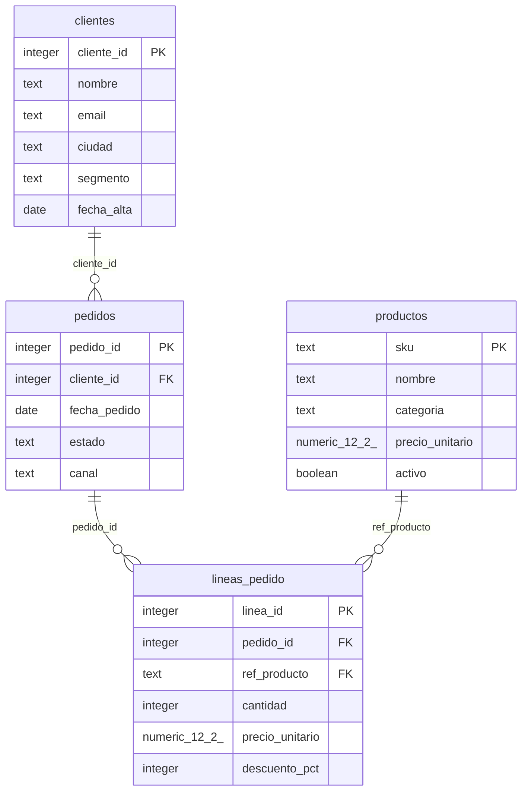

# Diccionario de datos — `proyecto_demo`

Generado automáticamente por DataOps Agent (`generar_diccionario`) el 2026-11-22 17:55 UTC.
Los hechos (tipos, claves, filas, linaje) salen del catálogo de PostgreSQL y de la
auditoría; las descripciones, de los comentarios del modelo (`COMMENT ON`).

**4 tablas · 4 vistas**

## Diagrama entidad-relación



## Tablas

### `clientes`

Una fila por cliente de la tienda; cargada desde clientes.csv.

- **Filas:** 500
- **Clave primaria:** cliente_id
- **Origen:** `clientes.csv` — plan `plan_4e77800a`
- **La usan las vistas:** v_lineas_venta
- **Preguntas de BI:** Clientes Campeones, Clientes con compras, Clientes por segmento RFM, Top 20 clientes por importe
- **Dashboards:** Clientes

| Columna | Tipo | Nulos | Descripción |
|---|---|---|---|
| `cliente_id` | integer | no | Identificador único del cliente (clave primaria). |
| `nombre` | text | no | Nombre y apellidos del cliente. Dato personal. |
| `email` | text | no | Correo electrónico del cliente. Dato personal. |
| `ciudad` | text | no | Ciudad o provincia de residencia del cliente. |
| `segmento` | text | no | Tipo de cliente: particular o empresa. |
| `fecha_alta` | date | no | Fecha en que el cliente se dio de alta. |

### `lineas_pedido`

Una fila por línea de pedido (producto dentro de un pedido); cargada desde lineas_pedido.csv.

- **Filas:** 7.516
- **Clave primaria:** linea_id
- **Relación:** pedido_id → `pedidos`(pedido_id)
- **Relación:** ref_producto → `productos`(sku)
- **Origen:** `lineas_pedido.csv` — plan `plan_90b57fbc`
- **La usan las vistas:** v_lineas_venta

| Columna | Tipo | Nulos | Descripción |
|---|---|---|---|
| `linea_id` | integer | no | Identificador único de la línea (clave primaria). |
| `pedido_id` | integer | no | Pedido al que pertenece la línea; apunta a pedidos.pedido_id. |
| `ref_producto` | text | no | Producto vendido; apunta a productos.sku. |
| `cantidad` | integer | no | Unidades vendidas en la línea. |
| `precio_unitario` | numeric(12,2) | no | Precio por unidad aplicado en la venta, en euros, antes del descuento. |
| `descuento_pct` | integer | no | Descuento aplicado a la línea, en porcentaje (0-100). |

### `pedidos`

Una fila por pedido (cabecera); cargada desde pedidos.csv.

- **Filas:** 3.000
- **Clave primaria:** pedido_id
- **Relación:** cliente_id → `clientes`(cliente_id)
- **Origen:** `pedidos.csv` — plan `plan_204dd3b8`
- **La usan las vistas:** v_lineas_venta
- **Preguntas de BI:** Importe medio por pedido, Importe neto y pedidos por mes (sin cancelados), Importe y pedidos por mes, Importe y pedidos por mes, Pedidos, Pedidos, Pedidos, Pedidos por estado, Pedidos por estado, Pedidos por estado, Pedidos por estado, Pedidos (sin cancelados), Pedidos (sin cancelados), Ticket medio, Ticket medio, Top 20 clientes por importe, Ventas y pedidos por mes
- **Dashboards:** Clientes, Resumen de ventas, Resumen de ventas, Resumen de ventas, Ventas, Ventas DataOps, Ventas DataOps, Ventas DataOps, Ventas DataOps

| Columna | Tipo | Nulos | Descripción |
|---|---|---|---|
| `pedido_id` | integer | no | Identificador único del pedido (clave primaria). |
| `cliente_id` | integer | no | Cliente que hizo el pedido; apunta a clientes.cliente_id. |
| `fecha_pedido` | date | no | Fecha en que se realizó el pedido. |
| `estado` | text | no | Estado del pedido: entregado, enviado, devuelto o cancelado. Las ventas excluyen solo los cancelados. |
| `canal` | text | no | Canal de venta: web, app o tienda. |

### `productos`

Catálogo de productos, una fila por producto; cargado desde productos.json.

- **Filas:** 80
- **Clave primaria:** sku
- **Origen:** `productos.json` — plan `plan_374ce85a`
- **La usan las vistas:** v_lineas_venta

| Columna | Tipo | Nulos | Descripción |
|---|---|---|---|
| `sku` | text | no | Referencia única del producto (clave primaria). Las líneas de pedido la citan como ref_producto. |
| `nombre` | text | no | Nombre comercial del producto. |
| `categoria` | text | no | Categoría del producto (Alimentación, Hogar, Electrónica, Libros, Deporte, Moda). |
| `precio_unitario` | numeric(12,2) | no | Precio de catálogo por unidad, en euros (IVA no confirmado). Las ventas usan el precio de la línea, no este. |
| `activo` | boolean | no | Indica si el producto sigue a la venta en el catálogo. |

## Vistas analíticas

### `v_lineas_venta`

Base de ventas: una fila por línea de pedido con datos del pedido, cliente y producto, e importe neto. Excluye pedidos cancelados (los devueltos sí cuentan).

- **Filas:** 6.669
- **Lee de:** clientes, lineas_pedido, pedidos, productos

| Columna | Tipo | Descripción |
|---|---|---|
| `linea_id` | integer | Identificador de la línea de pedido. |
| `pedido_id` | integer | Identificador del pedido. |
| `fecha_pedido` | date | Fecha del pedido. |
| `mes` | date | Primer día del mes del pedido. |
| `estado` | text | Estado del pedido (nunca cancelado). |
| `canal` | text | Canal de venta: web, app o tienda. |
| `cliente_id` | integer | Identificador del cliente. |
| `segmento` | text | Tipo de cliente: particular o empresa. |
| `ciudad` | text | Ciudad o provincia del cliente. |
| `sku` | text | Referencia del producto. |
| `producto` | text | Nombre del producto. |
| `categoria` | text | Categoría del producto. |
| `cantidad` | integer | Unidades vendidas. |
| `precio_unitario` | numeric(12,2) | Precio por unidad aplicado en la venta, en euros. |
| `descuento_pct` | integer | Descuento aplicado, en porcentaje. |
| `importe` | numeric | Importe neto de la línea en euros: cantidad * precio_unitario * (1 - descuento_pct/100), redondeado a 2 decimales. |

<details><summary>Definición SQL</summary>

```sql
SELECT l.linea_id,
    l.pedido_id,
    p.fecha_pedido,
    date_trunc('month'::text, p.fecha_pedido::timestamp with time zone)::date AS mes,
    p.estado,
    p.canal,
    p.cliente_id,
    c.segmento,
    c.ciudad,
    l.ref_producto AS sku,
    pr.nombre AS producto,
    pr.categoria,
    l.cantidad,
    l.precio_unitario,
    l.descuento_pct,
    round(l.cantidad::numeric * l.precio_unitario * (1::numeric - l.descuento_pct::numeric / 100.0), 2) AS importe
   FROM lineas_pedido l
     JOIN pedidos p ON p.pedido_id = l.pedido_id
     JOIN clientes c ON c.cliente_id = p.cliente_id
     JOIN productos pr ON pr.sku = l.ref_producto
  WHERE p.estado <> 'cancelado'::text;
```

</details>

### `v_ventas_mensuales`

Ventas por mes (una fila por mes): importe, pedidos, unidades y ticket medio. Excluye pedidos cancelados.

- **Filas:** 21
- **Lee de:** v_lineas_venta
- **Preguntas de BI:** Importe del último mes completo, Importe de ventas total, Importe medio por pedido, Importe neto mensual (sin cancelados), Importe neto mensual (sin cancelados), Importe neto por mes (sin cancelados), Importe neto total (sin cancelados), Importe neto y pedidos por mes (sin cancelados), Importe y pedidos por mes, Importe y pedidos por mes, Pedidos, Pedidos, Pedidos, Pedidos (sin cancelados), Pedidos (sin cancelados), Ticket medio, Ticket medio, Ventas del último mes frente al anterior, Ventas del último mes frente al anterior, Ventas mensuales (sin cancelados), Ventas totales, Ventas totales, Ventas totales (sin cancelados), Ventas y pedidos por mes
- **Dashboards:** Resumen de ventas, Resumen de ventas, Resumen de ventas, Ventas, Ventas DataOps, Ventas DataOps, Ventas DataOps, Ventas DataOps

| Columna | Tipo | Descripción |
|---|---|---|
| `mes` | date | Primer día del mes. |
| `importe` | numeric | Importe neto vendido en el mes, en euros. |
| `pedidos` | bigint | Número de pedidos distintos no cancelados del mes. |
| `unidades` | bigint | Unidades vendidas en el mes. |
| `ticket_medio` | numeric | Importe medio por pedido en el mes, en euros (importe / pedidos). |

<details><summary>Definición SQL</summary>

```sql
SELECT mes,
    sum(importe) AS importe,
    count(DISTINCT pedido_id) AS pedidos,
    sum(cantidad) AS unidades,
    round(sum(importe) / count(DISTINCT pedido_id)::numeric, 2) AS ticket_medio
   FROM v_lineas_venta
  GROUP BY mes;
```

</details>

### `v_ventas_por_canal`

Ventas por mes y canal (una fila por mes y canal). Excluye pedidos cancelados.

- **Filas:** 63
- **Lee de:** v_lineas_venta
- **Preguntas de BI:** Importe por canal y mes, Ventas por mes y canal
- **Dashboards:** Resumen de ventas, Resumen de ventas

| Columna | Tipo | Descripción |
|---|---|---|
| `mes` | date | Primer día del mes. |
| `canal` | text | Canal de venta: web, app o tienda. |
| `importe` | numeric | Importe neto vendido en el mes y canal, en euros. |
| `pedidos` | bigint | Número de pedidos distintos no cancelados del mes y canal. |

<details><summary>Definición SQL</summary>

```sql
SELECT mes,
    canal,
    sum(importe) AS importe,
    count(DISTINCT pedido_id) AS pedidos
   FROM v_lineas_venta
  GROUP BY mes, canal;
```

</details>

### `v_ventas_por_categoria`

Ventas por categoría de producto (una fila por categoría) en todo el histórico. Excluye pedidos cancelados.

- **Filas:** 6
- **Lee de:** v_lineas_venta
- **Preguntas de BI:** Importe por categoría, Importe por categoría, Reparto de las ventas por categoría, Reparto del importe por categoría, Reparto de ventas por categoría, Ventas por categoría, Ventas por categoría (sin cancelados)
- **Dashboards:** Resumen de ventas, Resumen de ventas, Resumen de ventas, Ventas

| Columna | Tipo | Descripción |
|---|---|---|
| `categoria` | text | Categoría del producto. |
| `importe` | numeric | Importe neto vendido de la categoría, en euros. |
| `pedidos` | bigint | Número de pedidos distintos que incluyen la categoría (un pedido puede contar en varias). |
| `unidades` | bigint | Unidades vendidas de la categoría. |

<details><summary>Definición SQL</summary>

```sql
SELECT categoria,
    sum(importe) AS importe,
    count(DISTINCT pedido_id) AS pedidos,
    sum(cantidad) AS unidades
   FROM v_lineas_venta
  GROUP BY categoria;
```

</details>
