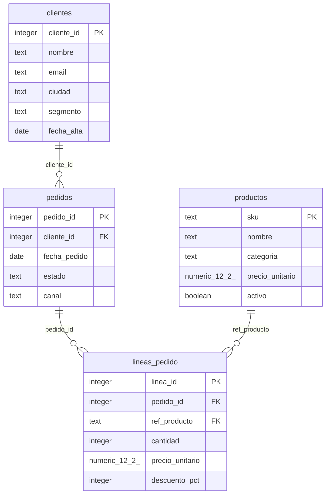

# Diccionario de datos — `proyecto_demo`

Generado automáticamente por DataOps Agent (`generar_diccionario`) el 2026-11-13 17:55 UTC.
Los hechos (tipos, claves, filas, linaje) salen del catálogo de PostgreSQL y de la
auditoría; las descripciones, de los comentarios del modelo (`COMMENT ON`).

**4 tablas · 2 vistas**

## Diagrama entidad-relación



## Tablas

### `clientes`

Una fila por cliente; cargada desde clientes.csv.

- **Filas:** 500
- **Clave primaria:** cliente_id
- **Origen:** `clientes.csv` — plan `plan_0f9a46c0`

| Columna | Tipo | Nulos | Descripción |
|---|---|---|---|
| `cliente_id` | integer | no | Identificador único del cliente (clave primaria). |
| `nombre` | text | no | Nombre del cliente (dato personal). |
| `email` | text | no | Correo electrónico de contacto del cliente (dato personal). |
| `ciudad` | text | no | Ciudad del cliente. |
| `segmento` | text | no | Tipo de cliente: 'particular' o 'empresa'. |
| `fecha_alta` | date | no | Fecha en que el cliente se dio de alta. |

### `lineas_pedido`

Una fila por línea de pedido (producto dentro de un pedido); cargada desde lineas_pedido.csv y la entrega de octubre 2026 (lineas_pedido_2026_10.csv, con precio renombrado, dividido entre 100 y sin duplicados exactos).

- **Filas:** 8.544
- **Clave primaria:** linea_id
- **Relación:** pedido_id → `pedidos`(pedido_id)
- **Relación:** ref_producto → `productos`(sku)
- **Origen:** `lineas_pedido.csv` — plan `plan_e4395912`
- **Origen:** `lineas_pedido_2026_10.csv` — plan `plan_0230fd23` (con transformación)
- **La usan las vistas:** v_ventas_mensuales, v_ventas_por_categoria

| Columna | Tipo | Nulos | Descripción |
|---|---|---|---|
| `linea_id` | integer | no | Identificador único de la línea (clave primaria). |
| `pedido_id` | integer | no | Pedido al que pertenece la línea; clave foránea a pedidos.pedido_id. |
| `ref_producto` | text | no | Producto vendido; clave foránea a productos.sku. |
| `cantidad` | integer | no | Unidades vendidas en la línea. |
| `precio_unitario` | numeric(12,2) | no | Precio por unidad aplicado en la línea, antes de descuento. Moneda e IVA no confirmados. |
| `descuento_pct` | integer | no | Descuento aplicado a la línea en porcentaje entero (0, 5, 10 o 20). Importe de línea = cantidad * precio_unitario * (1 - descuento_pct/100). |

### `pedidos`

Una fila por pedido (cabecera); cargada desde pedidos.csv y la entrega de octubre 2026 (pedidos_2026_10_dedup.csv).

- **Filas:** 3.400
- **Clave primaria:** pedido_id
- **Relación:** cliente_id → `clientes`(cliente_id)
- **Origen:** `pedidos.csv` — plan `plan_eb9a28cc`
- **Origen:** `pedidos_2026_10_dedup.csv` — plan `plan_313e98aa`
- **La usan las vistas:** v_ventas_mensuales, v_ventas_por_categoria

| Columna | Tipo | Nulos | Descripción |
|---|---|---|---|
| `pedido_id` | integer | no | Identificador único del pedido (clave primaria). |
| `cliente_id` | integer | no | Cliente que hace el pedido; clave foránea a clientes.cliente_id. |
| `fecha_pedido` | date | no | Fecha en que se realizó el pedido. |
| `estado` | text | no | Estado del pedido: 'enviado', 'entregado', 'devuelto' o 'cancelado'. Las vistas de ventas excluyen solo 'cancelado'. |
| `canal` | text | no | Canal de venta: 'web', 'app' o 'tienda'. |

### `productos`

Una fila por producto del catálogo; cargada desde productos.json.

- **Filas:** 80
- **Clave primaria:** sku
- **Origen:** `productos.json` — plan `plan_574bed11`
- **La usan las vistas:** v_ventas_por_categoria

| Columna | Tipo | Nulos | Descripción |
|---|---|---|---|
| `sku` | text | no | Código único del producto (clave primaria); referenciado por lineas_pedido.ref_producto. |
| `nombre` | text | no | Nombre comercial del producto. |
| `categoria` | text | no | Categoría del producto: Alimentación, Deporte, Electrónica, Hogar, Libros o Moda. |
| `precio_unitario` | numeric(12,2) | no | Precio de catálogo por unidad. Moneda e IVA no confirmados. |
| `activo` | boolean | no | Indica si el producto sigue a la venta (true) o está descatalogado (false). |

## Vistas analíticas

### `v_ventas_mensuales`

Ventas agregadas por mes de pedido (una fila por mes). Excluye pedidos con estado 'cancelado'; incluye los devueltos.

- **Filas:** 22
- **Lee de:** lineas_pedido, pedidos

| Columna | Tipo | Descripción |
|---|---|---|
| `mes` | date | Primer día del mes de la fecha de pedido. |
| `pedidos` | bigint | Número de pedidos distintos del mes. |
| `unidades` | bigint | Suma de unidades vendidas. |
| `importe` | numeric | Suma de importes de línea con descuento aplicado, redondeada a 2 decimales. Moneda e IVA no confirmados. |

<details><summary>Definición SQL</summary>

```sql
SELECT date_trunc('month'::text, p.fecha_pedido::timestamp with time zone)::date AS mes,
    count(DISTINCT p.pedido_id) AS pedidos,
    sum(l.cantidad) AS unidades,
    round(sum(l.cantidad::numeric * l.precio_unitario * (1::numeric - l.descuento_pct::numeric / 100.0)), 2) AS importe
   FROM pedidos p
     JOIN lineas_pedido l ON l.pedido_id = p.pedido_id
  WHERE p.estado <> 'cancelado'::text
  GROUP BY (date_trunc('month'::text, p.fecha_pedido::timestamp with time zone)::date);
```

</details>

### `v_ventas_por_categoria`

Ventas agregadas por categoría de producto (una fila por categoría, todo el histórico). Excluye pedidos con estado 'cancelado'; incluye los devueltos.

- **Filas:** 6
- **Lee de:** lineas_pedido, pedidos, productos

| Columna | Tipo | Descripción |
|---|---|---|
| `categoria` | text | Categoría del producto (productos.categoria). |
| `pedidos` | bigint | Número de pedidos distintos que incluyen algún producto de la categoría. |
| `unidades` | bigint | Suma de unidades vendidas de la categoría. |
| `importe` | numeric | Suma de importes de línea con descuento aplicado, redondeada a 2 decimales. Moneda e IVA no confirmados. |

<details><summary>Definición SQL</summary>

```sql
SELECT pr.categoria,
    count(DISTINCT p.pedido_id) AS pedidos,
    sum(l.cantidad) AS unidades,
    round(sum(l.cantidad::numeric * l.precio_unitario * (1::numeric - l.descuento_pct::numeric / 100.0)), 2) AS importe
   FROM pedidos p
     JOIN lineas_pedido l ON l.pedido_id = p.pedido_id
     JOIN productos pr ON pr.sku = l.ref_producto
  WHERE p.estado <> 'cancelado'::text
  GROUP BY pr.categoria;
```

</details>
